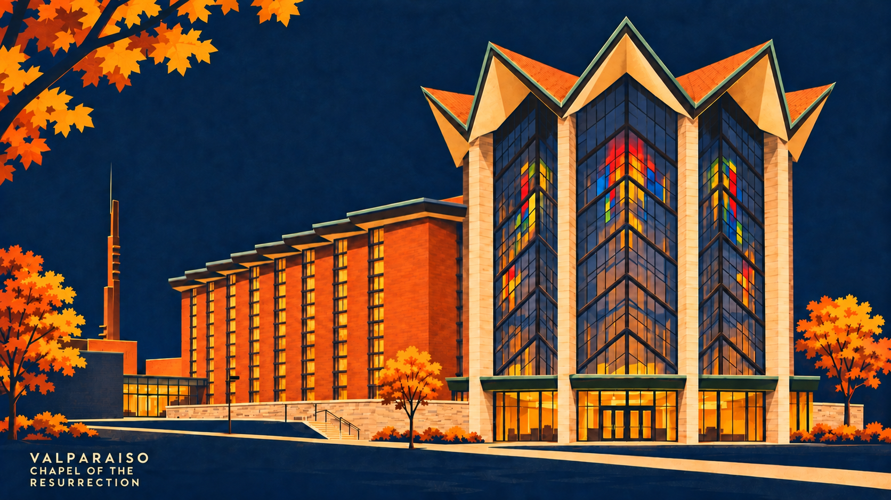
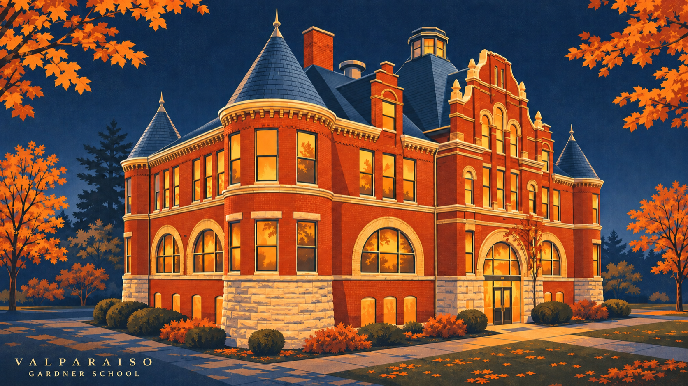
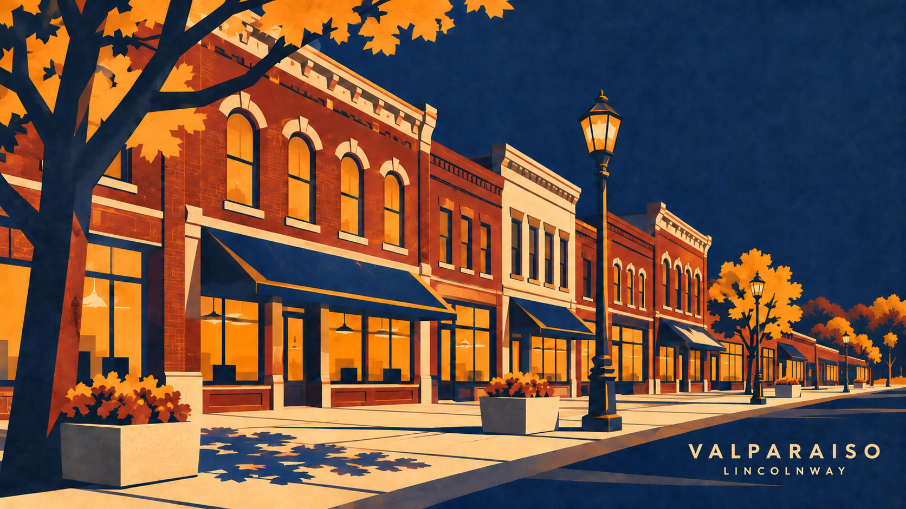
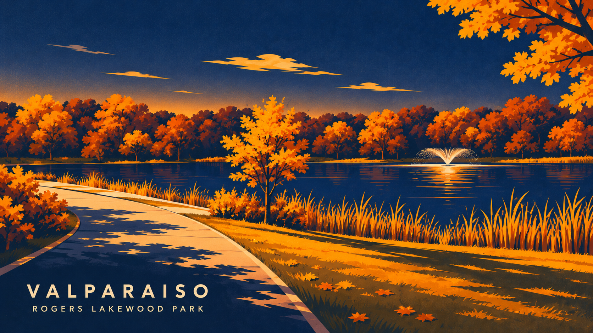
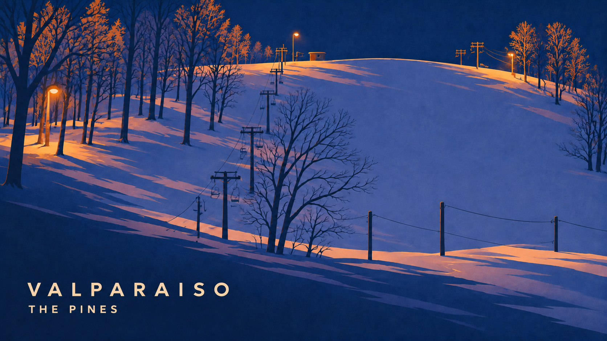

# Valparaiso Background Images

A collection of custom-created background images featuring scenes from around **Valparaiso, Indiana**, shared freely for anyone who would like to use them as desktop wallpapers, video call backgrounds, or in their own projects.

## Image Details

- **Format:** PNG
- **Resolution:** 1672 × 941

To grab any image, click it below to view the full-resolution file and save it, or clone this repository:

```bash
git clone https://github.com/Valparaiso-OS/background-images.git
```

## Scenes

### Chapel of the Resurrection
[`chapel-captioned.png`](./chapel-captioned.png)



### Gardner School
[`gardner-captioned.png`](./gardner-captioned.png)



### Lincolnway
[`lincolnway-captioned.png`](./lincolnway-captioned.png)



### Rogers Lakewood Park
[`rogers-lakewood-captioned.png`](./rogers-lakewood-captioned.png)



### The Pines
[`the-pines-captioned.png`](./the-pines-captioned.png)



## License

These images are shared under the [MIT License](./LICENSE) — feel free to download, use, and share them.
